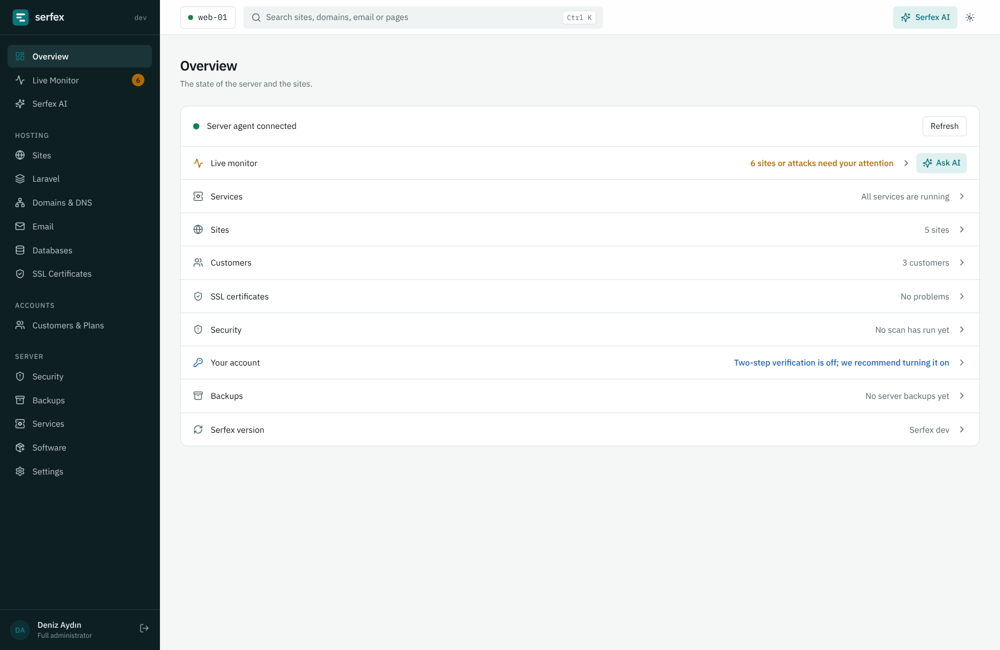
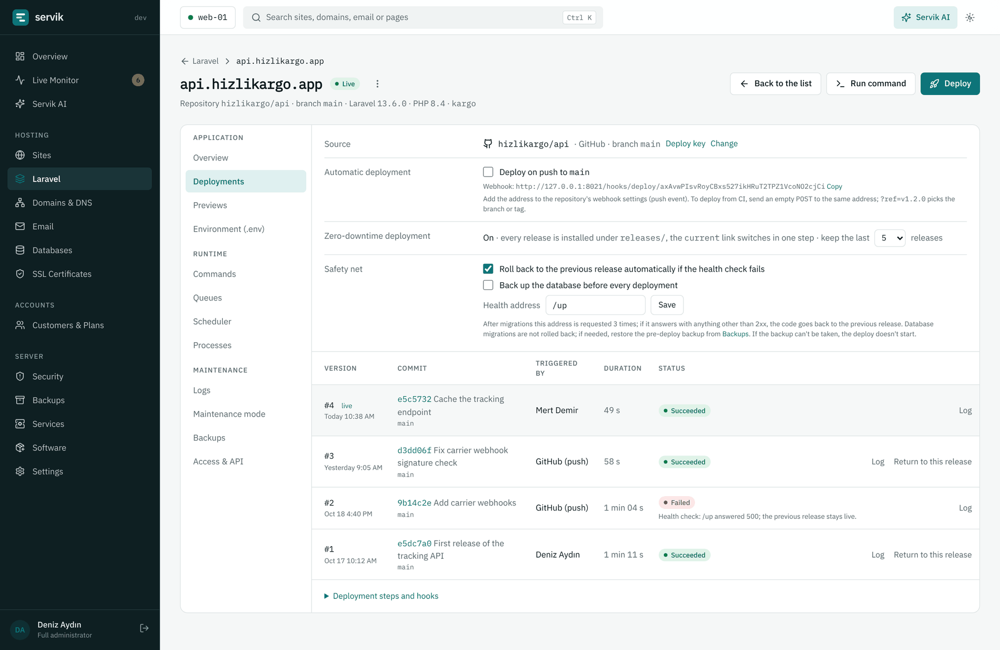
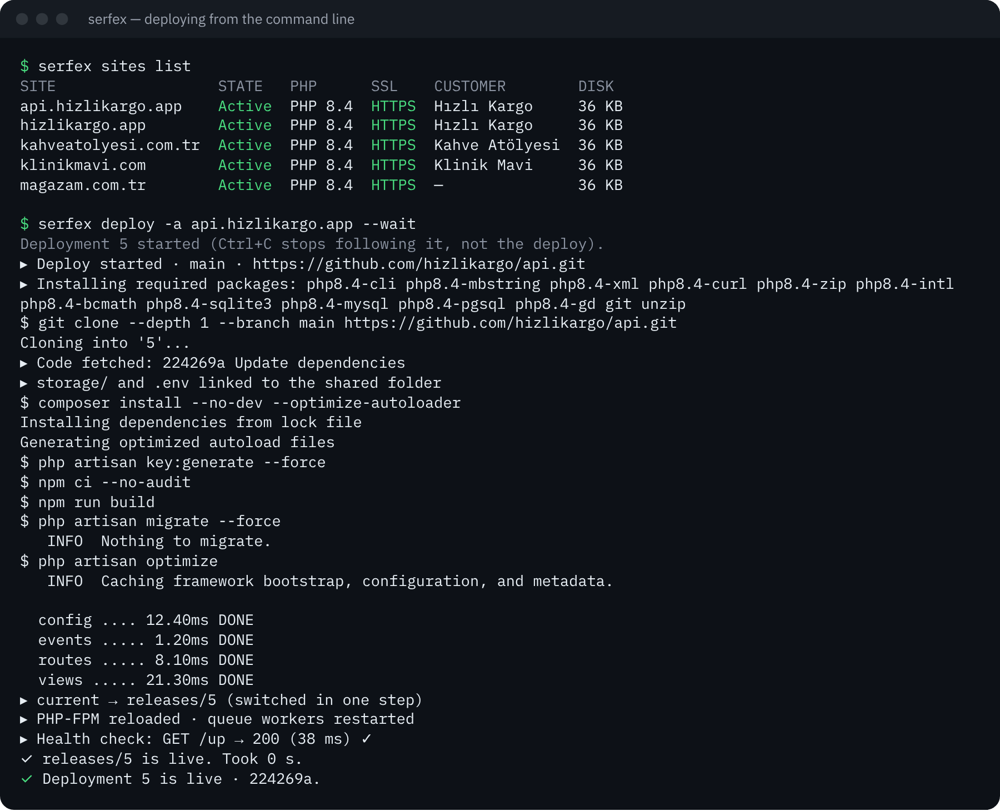
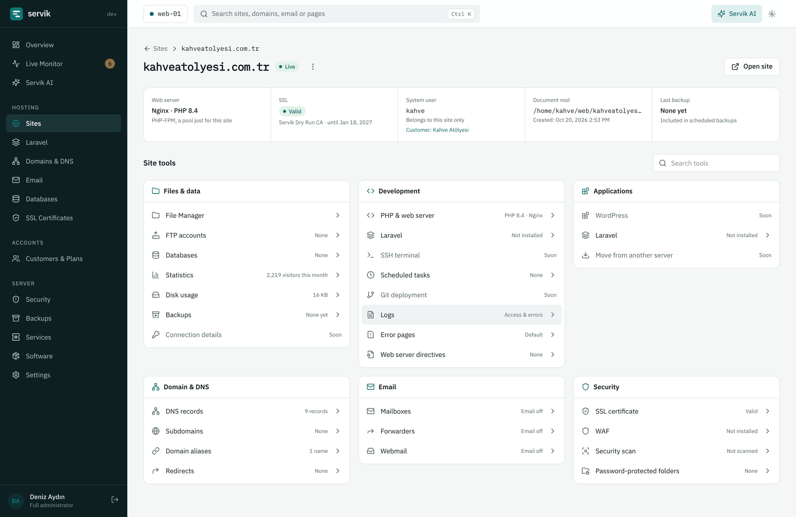
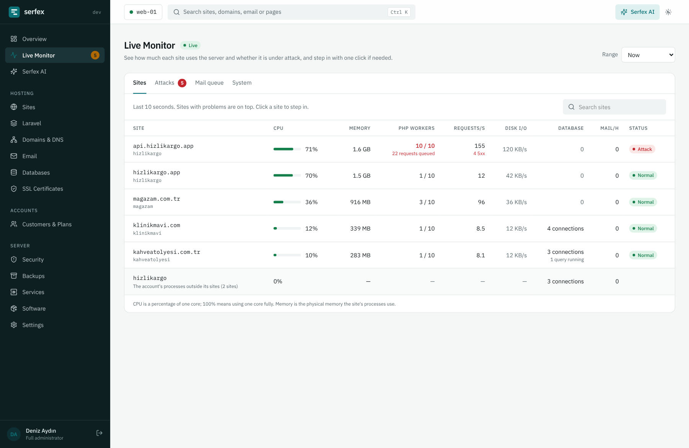

<h1>
  <picture>
    <source media="(prefers-color-scheme: dark)" srcset="docs/images/serfex-logo-dark.svg">
    
  </picture>
</h1>

**An open-source web hosting control panel for Ubuntu servers, with a
first-class toolkit for Laravel applications.**

Serfex runs websites, DNS, mail, databases, certificates and backups for you
and your customers from one panel, and deploys Laravel applications with
zero-downtime releases, previews, queues and a command line built in.

[](https://github.com/CallTech-App/Serfex/releases/latest)
[](LICENSE)


[Türkçe](README.tr.md) · [Documentation](docs/README.md) · [Install](docs/installation.md) · [Command line](docs/cli.md) · [API](docs/api.md)



> **Status:** Serfex is young (the 0.1 series) and changes quickly. Most
> features below have real-server tests in CI, but Serfex has not yet run
> production hosting for long. Try it on a fresh server first; see
> [Status](#status-and-roadmap).

## Highlights

**Laravel toolkit.** Add an application from a Git repository or start a new
one (plain Laravel or a React, Vue or Livewire starter kit), and Serfex
builds each release in its own directory, runs Composer, your front-end build
and migrations, switches over atomically and checks `/up`. A failed health
check rolls back on its own. Each application gets:

- the repository and branch picked from your connected GitHub, GitLab or
  Bitbucket account, with the deploy key and webhook added for you;
- deployments from a push webhook or one click, with build hooks and the last
  five releases kept for rollback;
- preview environments for pull requests at `pr-<n>.<domain>`;
- `.env` editing, Artisan / Composer / npm commands with live output, Tinker;
- queue workers, the scheduler (each task can be paused on its own), Horizon,
  Octane and Reverb as managed processes;
- logs, maintenance mode with an IP allowlist, its own backups and its own Redis;
- per-application access for developers and deploy tokens for CI.

**Application templates.** Describe your own Laravel application once, from a
Git repository or from a release zip that later updates itself, with its
database, `.env` lines, install questions and first commands. Then install it
on any site in one step. Templates stay in your panel's database, not in this
repository.



**Command line.** `serfex` drives the panel from a server or a laptop:
sites, domains, DNS, certificates, mail, databases, backups, services,
customers and Laravel deployments. It signs in through the browser, prints
`--json` for scripts, and works in CI with an application's token.

```sh
serfex login panel.example.com:8443
serfex deploy -a api.example.com --wait
```



**A whole hosting panel.**

- **Sites**: each site has its own system user and PHP-FPM pool; Nginx, or
  Apache behind Nginx, per site; PHP 8.1 to 8.5 side by side; subdomains,
  aliases, a preferred address (with or without `www.`), redirects, error
  pages, a file manager, FTP accounts, SSH access (SFTP locked to the site's
  home folder, or a shell), cron jobs, Composer and a Node.js version per site,
  cache and speed settings, traffic statistics and logs. An address the server
  does not host gets a "No site at this address" page, never another site.
- **Staging**: copy a site to `staging.<domain>` with its databases, hidden
  from search engines; refresh it from the live site, and push it back to live
  with a backup first and an undo.
- **Moving in**: bring accounts over from cPanel (a full account backup) or
  from Plesk (over SSH): sites, databases, mailboxes with their old passwords,
  DNS zones and certificates, with a preview before anything changes.
- **WordPress**: one-click install with its own database, or manage one already
  on the site; updates of WordPress, plugins and themes with a restore point and
  automatic rollback, one-click sign-in, maintenance mode and hardening rules.
- **DNS**: its own authoritative DNS server (PowerDNS). Adding a site writes
  its zone, and mail and certificates fill in their own records. DNSSEC in
  one click, and secondary DNS servers that pick up new zones on their own
  (catalog zones).
- **SSL**: Let's Encrypt for every site and alias, wildcards when the DNS is
  local, also for names behind Cloudflare's proxy, renewal 30 days ahead,
  uploads for other certificates.
- **Email**: Postfix, Dovecot and Rspamd set up in one step, with SPF, DKIM
  and DMARC written for you, quotas, forwarders, catch-all, and webmail with
  Roundcube or SnappyMail.
- **Databases**: MySQL or MariaDB, and PostgreSQL alongside (with pgvector),
  with users, grants, remote access, one-click phpMyAdmin or Adminer, and
  upgrades to a new major version with automatic rollback.
- **Customers and plans**: limits and features per plan, disk quotas the file
  system enforces, suspension, and a customer panel that shows only their own
  hosting.
- **Live monitoring**: which site is using the CPU, memory, PHP workers or
  database right now, and who is attacking it, with one-click IP blocks and
  temporary resource limits.
- **Security**: firewall, ModSecurity WAF, malware and outdated-software
  scans, Fail2ban, two-factor sign-in, password reset by email, security
  headers on the panel, SSH settings.
- **Backups**: whole server or one site, full and incremental, to local disk,
  S3-compatible storage or SFTP, with selective restore.
- **Serfex AI**: an assistant that reads the server's state, explains what is
  wrong and proposes fixes you approve. On its own it may only block an
  address or limit a site for a while (you can turn that off). It uses your
  own Claude API key.
- **Updates** from the panel with a backup first and automatic rollback, an
  activity log with undo, administrator roles, notifications by email and
  webhook, a REST API, and Turkish and English throughout.





## Install

On a fresh Ubuntu Server 24.04 or newer (amd64 or arm64), as root:

```sh
curl -fsSL https://github.com/CallTech-App/Serfex/releases/latest/download/install.sh -o install.sh
sudo bash install.sh
```

Add `--lang tr` to the last line for a Turkish panel. It takes a few minutes
and ends with a one-time setup link. Open it to create the administrator
account (lost it? `sudo serfex setup-url` prints a new one); a setup wizard
then walks through the host name, name servers, time zone, the panel's address
and certificate, notifications, the firewall, defaults and backups. Everything else
(DNS, mail, database servers, more PHP versions) is installed from the panel
when you need it. See [Installation](docs/installation.md) for options,
ports and first steps.

The command line alone, on Linux or macOS:

```sh
curl -fsSL https://github.com/CallTech-App/Serfex/releases/latest/download/install-cli.sh | sh
```

## Requirements

- A fresh server with Ubuntu Server 24.04 LTS or newer, amd64 or arm64, and
  root access. Do not install Serfex next to another control panel.
- A public IPv4 address (IPv6 is used when present) and a host name that
  resolves to it, for certificates and mail.
- 2 GB of memory for a small server with mail and a database server; 4 GB or
  more if you host Laravel applications with queues and builds.

## How it works

Serfex is three programs in this repository:

| Directory | What it is | Runs as |
|-----------|------------|---------|
| [`panel/`](panel) | The web panel: Laravel 13 and Livewire 4, with its own PostgreSQL database. | The `serfex` user |
| [`agent/`](agent) | `serfex-agent`: one static Go binary that does the root-level work (web server, PHP-FPM, DNS, mail, certificates, users, firewall, backups). | `root`, under systemd |
| [`cli/`](cli) | `serfex`: the command line, a client of the panel's `/api/v1`. | Anyone |

The panel never runs as root. It asks the agent for each change over a local
Unix socket with JSON-RPC 2.0, and the agent only offers narrow,
validated methods: no "run this command". The panel's own PHP, web server and
PostgreSQL are kept apart from the ones customer sites use. Read
[Architecture](docs/architecture.md) for the details.

## Status and roadmap

0.1 covers everything a single server needs to host sites, mail and Laravel
applications for paying customers. Known gaps, planned for later releases:

- an SSH terminal in the browser (shown as "Soon" in the panel);
- backing up mailboxes on their own, CalDAV and CardDAV;
- Slack and Telegram notifications;
- signed releases (releases are checked with SHA-256 today);
- more than one server per panel, and distributions other than Ubuntu.

Bug reports and ideas are welcome in [Issues](https://github.com/CallTech-App/Serfex/issues).

## Documentation

- [Installation and first steps](docs/installation.md)
- [Administrator guide](docs/README.md#administrator-guide)
- [Customer guide](docs/customer-guide.md)
- [Laravel toolkit](docs/laravel.md)
- [Command line reference](docs/cli.md)
- [API reference](docs/api.md)
- [Architecture](docs/architecture.md)
- [Development](docs/development.md)

## Contributing

See [CONTRIBUTING.md](CONTRIBUTING.md) and [Development](docs/development.md).
Please report security problems privately, as described in [SECURITY.md](SECURITY.md).

## License

Serfex is free software under the [GNU Affero General Public License v3.0](LICENSE).
If you run a modified Serfex for others, the AGPL asks you to offer them your
changes.
