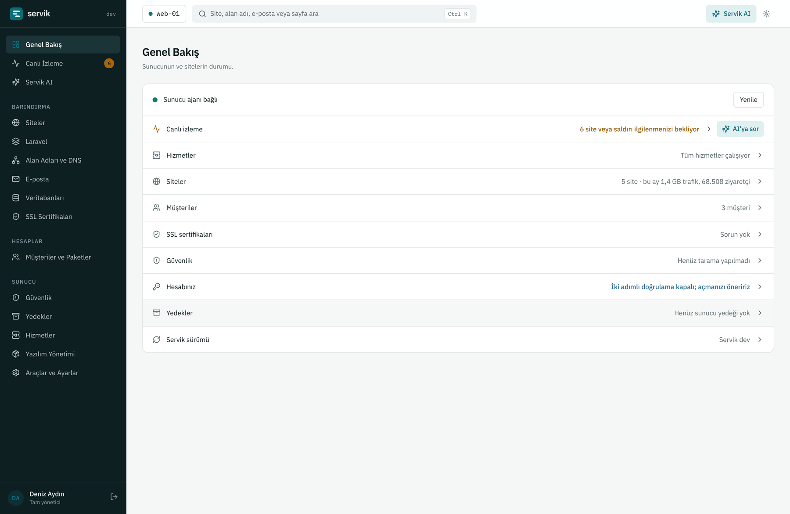
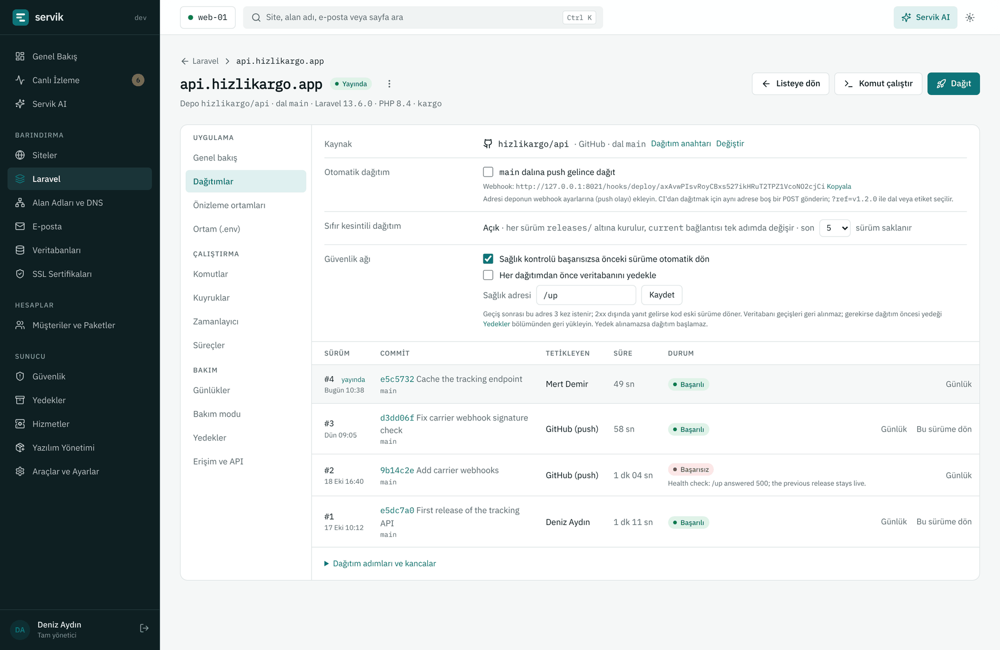
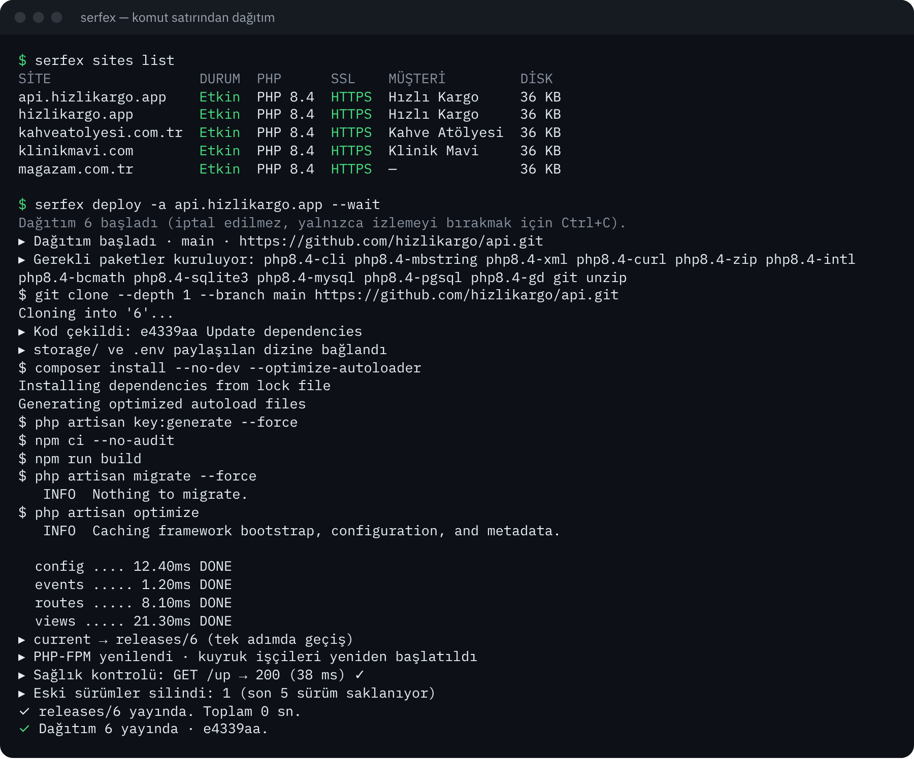
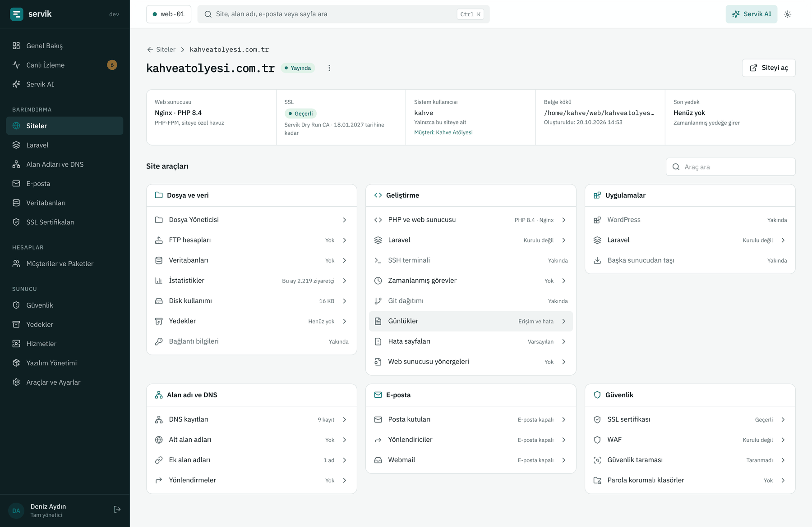
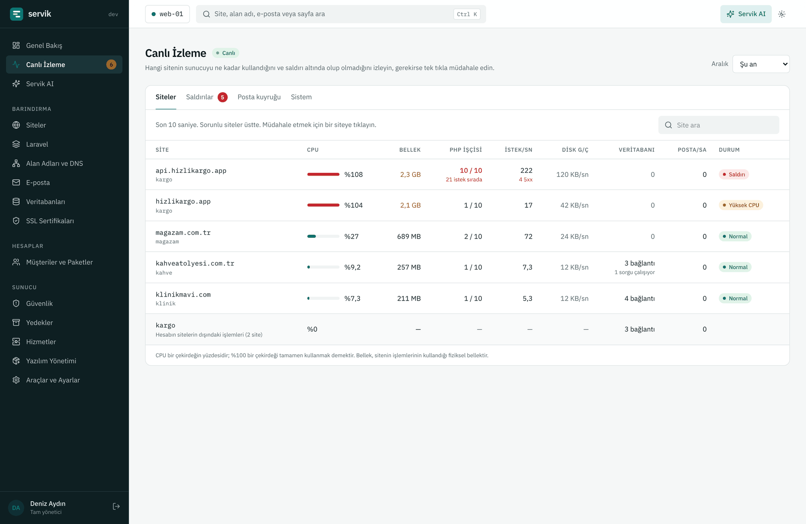

# Servik

**Ubuntu sunucular için açık kaynak bir web hosting kontrol paneli; Laravel
uygulamaları için birinci sınıf bir araç setiyle.**

Servik siteleri, DNS'i, e-postayı, veritabanlarını, sertifikaları ve
yedekleri sizin ve müşterileriniz için tek panelden yönetir; Laravel
uygulamalarını kesintisiz sürümler, önizleme ortamları, kuyruklar ve hazır bir
komut satırıyla dağıtır.

[English](README.md) · [Belgeler](docs/README.md) · [Kurulum](docs/tr/kurulum.md) · [Komut satırı](docs/tr/cli.md) · [API](docs/api.md)



> **Durum:** Servik 0.1 ilk herkese açık sürümdür. Aşağıdaki her özellik
> çalışıyor ve CI'da gerçek sunucu testleri var, ama henüz uzun süre canlı
> hosting yapmadı. Önce boş bir sunucuda deneyin; bkz. [Durum ve yol haritası](#durum-ve-yol-haritası).

## Öne çıkanlar

**Laravel araç seti.** Bir Git deposundan uygulama ekleyin ya da yeni bir proje
başlatın (yalın Laravel veya React, Vue, Livewire başlangıç kiti). Servik her
sürümü kendi klasöründe kurar; Composer'ı, ön yüz derlemesini ve migration'ları
çalıştırır, tek adımda yeni sürüme geçer ve `/up` adresini denetler. Sağlık
denetimi başarısız olursa kendiliğinden geri döner. Her uygulamada:

- GitHub, GitLab, Bitbucket push webhook'u ya da tek tıkla dağıtım; derleme
  kancaları ve geri dönmek için son beş sürüm;
- pull request'ler için `pr-<n>.<alan adı>` önizleme ortamları;
- `.env` düzenleme, canlı çıktılı Artisan / Composer / npm komutları, Tinker;
- yönetilen süreçler olarak kuyruk işçileri, zamanlayıcı, Horizon, Octane ve Reverb;
- günlükler, IP izin listeli bakım modu, kendi yedekleri ve kendi Redis'i;
- geliştiriciler için uygulama bazında erişim ve CI için dağıtım anahtarları.



**Komut satırı.** `servik`, paneli sunucudan ya da dizüstü bilgisayardan
yönetir: siteler, alan adları, DNS, sertifikalar, e-posta, veritabanları,
yedekler, hizmetler, müşteriler ve Laravel dağıtımları. Tarayıcıdan onayla
giriş yapar, betikler için `--json` verir, CI'da uygulamanın anahtarıyla çalışır.

```sh
servik login panel.ornek.com:8443
servik deploy -a api.ornek.com --wait
```



**Eksiksiz bir hosting paneli.**

- **Siteler:** her sitenin kendi sistem kullanıcısı ve PHP-FPM havuzu; site
  bazında Nginx ya da Nginx arkasında Apache; yan yana PHP 8.1–8.5; alt alan
  adları, ek alan adları, yönlendirmeler, hata sayfaları, dosya yöneticisi,
  SFTP hesapları, zamanlanmış görevler, trafik istatistikleri ve günlükler.
- **DNS:** kendi yetkili DNS sunucusu (PowerDNS). Site eklemek bölgesini yazar;
  e-posta ve sertifikalar kendi kayıtlarını ekler.
- **SSL:** her site ve ek alan adı için Let's Encrypt, DNS yerelse joker
  sertifika, bitişten 30 gün önce yenileme, başka sertifikalar için yükleme.
- **E-posta:** Postfix, Dovecot ve Rspamd tek adımda; SPF, DKIM ve DMARC
  kendiliğinden yazılır; kota, yönlendirici, tümünü yakala ve webmail.
- **Veritabanları:** MySQL ya da MariaDB, yanında PostgreSQL; kullanıcılar,
  yetkiler, uzaktan erişim ve tek tıkla phpMyAdmin ya da Adminer.
- **Müşteriler ve paketler:** paket bazında sınırlar ve özellikler, kotalar,
  askıya alma ve müşterinin yalnızca kendi hostingini gördüğü müşteri paneli.
- **Canlı izleme:** şu anda hangi sitenin CPU, bellek, PHP işçisi ya da
  veritabanı kullandığı ve kimin saldırdığı; tek tıkla IP engeli ve geçici
  kaynak sınırı.
- **Güvenlik:** güvenlik duvarı, ModSecurity WAF, zararlı yazılım ve eski
  yazılım taraması, Fail2ban, iki adımlı giriş, SSH ayarları.
- **Yedekler:** tüm sunucu ya da tek site, tam ve artımlı; yerel disk,
  S3 uyumlu depolama ya da SFTP; seçerek geri yükleme.
- **Servik AI:** sunucunun durumunu okuyan, sorunu açıklayan ve sizin
  onaylayacağınız düzeltmeler öneren bir asistan. Kendi başına yalnızca bir
  adresi engelleyebilir ya da bir siteyi bir süre sınırlayabilir (bunu
  kapatabilirsiniz). Kendi Claude API anahtarınızla çalışır.
- Önce yedek alıp sorun olursa kendiliğinden geri dönen panelden
  **güncellemeler**, geri alınabilen işlem günlüğü, yönetici rolleri,
  e-posta ve webhook bildirimleri, REST API, baştan sona Türkçe ve İngilizce.





## Kurulum

Boş bir Ubuntu Server 24.04 ya da daha yenisinde (amd64 veya arm64), root olarak:

```sh
curl -fsSL https://github.com/CallTech-App/Serfex/releases/latest/download/install.sh -o install.sh
sudo bash install.sh --lang tr
```

Birkaç dakika sürer ve tek kullanımlık bir kurulum bağlantısıyla biter.
Bağlantıyı açıp yönetici hesabını oluşturursunuz; ardından bir kurulum
sihirbazı sunucu adı, ad sunucuları, saat dilimi, panelin adresi ve
sertifikası, bildirimler, güvenlik duvarı, varsayılanlar ve yedekler için
adım adım yol gösterir. Geri kalan her şey (DNS, e-posta,
veritabanı sunucuları, başka PHP sürümleri) gerektiğinde panelden kurulur.
Seçenekler, portlar ve ilk adımlar için [Kurulum](docs/tr/kurulum.md).

Yalnızca komut satırı, Linux ya da macOS'ta:

```sh
curl -fsSL https://github.com/CallTech-App/Serfex/releases/latest/download/install-cli.sh | sh
```

## Gereksinimler

- Ubuntu Server 24.04 LTS ya da daha yenisi kurulu, amd64 veya arm64, root
  erişimli boş bir sunucu. Servik'i başka bir kontrol panelinin yanına kurmayın.
- Herkese açık bir IPv4 adresi (varsa IPv6 da kullanılır) ve bu adrese
  çözümlenen bir sunucu adı; sertifikalar ve e-posta için.
- E-posta ve bir veritabanı sunucusu olan küçük bir sunucu için 2 GB bellek;
  kuyruklu ve derlemeli Laravel uygulamaları barındıracaksanız 4 GB ya da fazlası.

## Nasıl çalışır

Servik bu depodaki üç programdan oluşur:

| Klasör | Ne | Kimle çalışır |
|--------|----|---------------|
| [`panel/`](panel) | Web paneli: Laravel 13 ve Livewire 4, kendi PostgreSQL veritabanıyla. | `servik` kullanıcısı |
| [`agent/`](agent) | `servik-agent`: root gerektiren işleri (web sunucusu, PHP-FPM, DNS, e-posta, sertifikalar, kullanıcılar, güvenlik duvarı, yedekler) yapan tek, statik bir Go programı. | systemd altında `root` |
| [`cli/`](cli) | `servik`: komut satırı, panelin `/api/v1` istemcisi. | Herkes |

Panel hiçbir zaman root çalışmaz. Her değişikliği yerel bir Unix soketi
üzerinden JSON-RPC 2.0 ile ajandan ister; ajan yalnızca dar ve denetlenen
yöntemler sunar, "şu komutu çalıştır" diye bir yöntem yoktur. Panelin kendi
PHP'si, web sunucusu ve PostgreSQL'i müşteri sitelerinin kullandıklarından
ayrıdır. Ayrıntılar: [Mimari](docs/architecture.md) (İngilizce).

## Durum ve yol haritası

0.1, tek bir sunucunun ücretli müşteriler için site, e-posta ve Laravel
uygulaması barındırması için gereken her şeyi kapsar. Bilinen eksikler,
sonraki sürümler için planlı:

- WordPress araç seti, tarayıcıda SSH terminali ve başka sunucudan site taşıma
  (panelde "Yakında" olarak görünür);
- DNSSEC ve ikincil DNS sunucuları;
- cPanel ve Plesk yedeklerini içe aktarma, posta kutularının ayrı yedeği,
  CalDAV ve CardDAV;
- Slack ve Telegram bildirimleri;
- imzalı sürümler (sürümler bugün SHA-256 ile denetleniyor);
- bir panelden birden fazla sunucu ve Ubuntu dışındaki dağıtımlar.

Hata bildirimleri ve öneriler [Issues](https://github.com/CallTech-App/Serfex/issues) sayfasına.

## Belgeler

- [Kurulum ve ilk adımlar](docs/tr/kurulum.md)
- [Yönetici kılavuzu](docs/README.md#administrator-guide) (İngilizce)
- [Müşteri kılavuzu](docs/tr/musteri-kilavuzu.md)
- [Laravel araç seti](docs/laravel.md) (İngilizce)
- [Komut satırı başvurusu](docs/tr/cli.md)
- [API başvurusu](docs/api.md) (İngilizce)
- [Mimari](docs/architecture.md) (İngilizce)
- [Geliştirme](docs/development.md) (İngilizce)

## Katkı

[CONTRIBUTING.md](CONTRIBUTING.md) ve [Geliştirme](docs/development.md) belgelerine bakın.
Güvenlik açıklarını [SECURITY.md](SECURITY.md) belgesindeki gibi gizli olarak bildirin.

## Lisans

Servik, [GNU Affero Genel Kamu Lisansı v3.0](LICENSE) altında özgür yazılımdır.
Değiştirdiğiniz bir Servik'i başkalarına hizmet olarak sunuyorsanız AGPL,
değişikliklerinizi onlara da sunmanızı ister.
